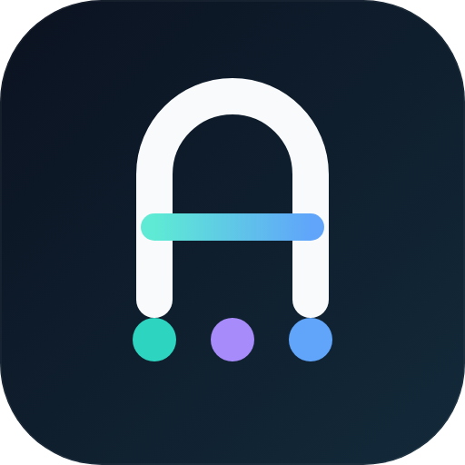
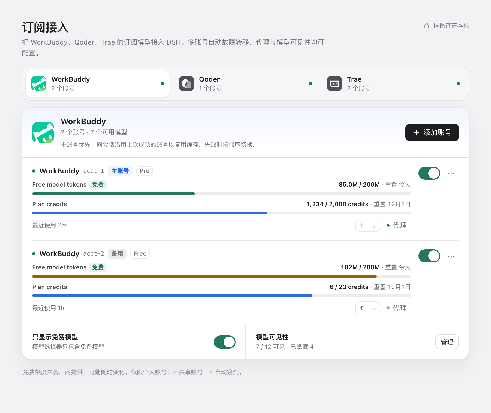
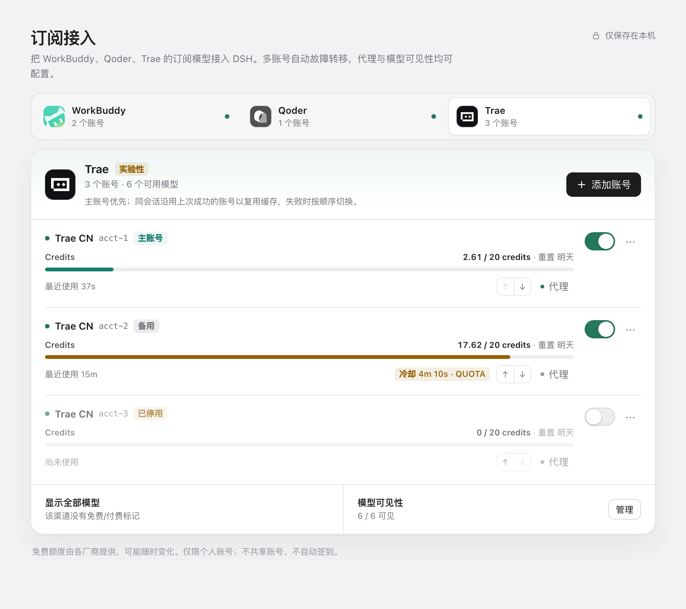
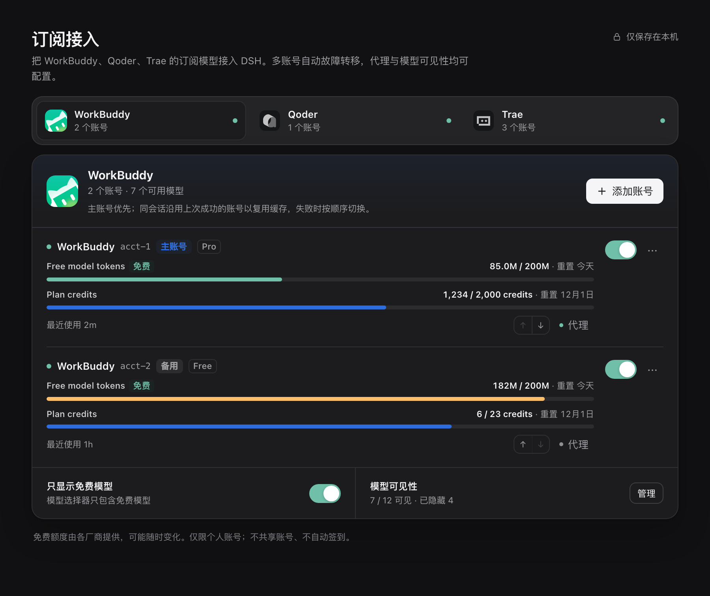
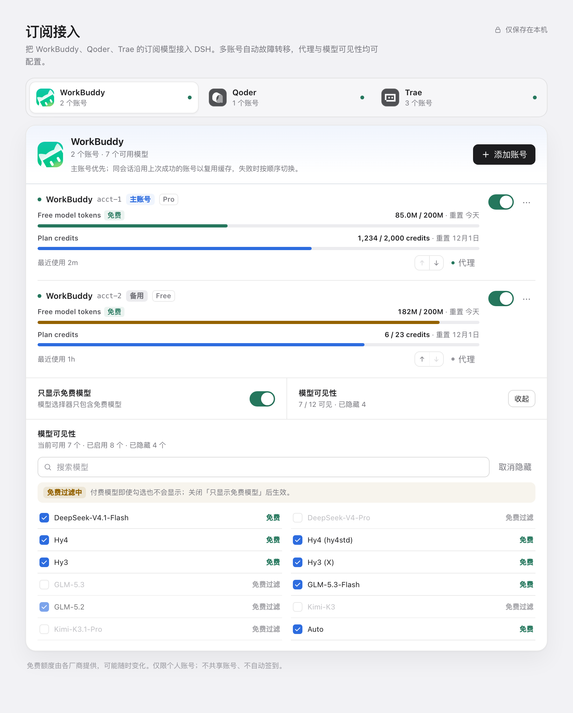

<p align="center">
  
</p>

<h1 align="center">dsh-hitchfin</h1>

<p align="center">
  <strong>Use your existing WorkBuddy, Qoder and Trae subscriptions inside DeepSeek Harness.</strong>
</p>
<p align="center">
  Multi-account priority and failover · per-account HTTP(S) proxies · free-model filter · model visibility
</p>

<p align="center">
  <a href="README.md">简体中文</a> ·
  <a href="#installation">Installation</a> ·
  <a href="#quick-start">Quick start</a> ·
  <a href="#features">Features</a> ·
  <a href="#channels">Channels</a> ·
  <a href="#multi-account-routing">Routing</a> ·
  <a href="#development">Development</a>
</p>

<p align="center">
  
  
  
  
</p>



## Why dsh-hitchfin

DSH already has first-class API-key providers. `dsh-hitchfin` covers the other case: subscription plans you already pay for, accessed through their official account login flows.

It adds WorkBuddy CN, Qoder CN and Trae CN as native DSH model providers. Sign in with an official account, and the models you are entitled to appear in the DSH model picker. No account sharing, no automatic check-in, no attempt to bypass vendor limits.

## Installation

### From the DSH plugin market

Once listed, open **Plugins → Discover**, search for **dsh-hitchfin**, and install it from the card. Restart DSH if the host asks you to.

### Directly from the GitHub repository (web / CLI profiles)

No need to wait for the market listing. Install straight from the repo; the plugin is built automatically during install, which needs Node.js ≥ 20.18.1 and git.

```sh
dsh plugin --profile web add github:LuckyOneTwoThree/dsh-hitchfin
```

To pin a version, use a tag or commit, for example `github:LuckyOneTwoThree/dsh-hitchfin#v0.5.2`. Restart DSH when prompted.

> If your npm asks you to approve the package's install script (`prepare`), allow it; it only runs `npm run build`.

### From npm (web / CLI profiles)

```sh
dsh plugin --profile web add dsh-hitchfin
```

### From a local build

```sh
npm install
npm run build
npm pack
dsh plugin --profile web add ./dsh-hitchfin-0.5.2.tgz
```

> The DSH Desktop profile is managed by the Electron application. Install through the app's **Plugins** page or the plugin market rather than editing the desktop profile by hand.

Requirements are listed under [Compatibility](#compatibility).

## Quick start

1. Open **Settings → 订阅接入** and pick a channel.
2. Choose a sign-in method. Browser sign-in opens your default browser automatically; use API Key / PAT where the channel offers it.
3. Keep **Free models only** enabled unless you explicitly want paid models.
4. The channel's models appear in the DSH model picker. Add a second account or reorder the failover list at any time.

## Features

- **Official channels** — WorkBuddy CN, Qoder CN and Trae CN, with their official app icons and official login flows.
- **Multi-account** — set a primary account, reorder failover, or disable an account without deleting its credentials, proxy and settings. Each card shows its role, last use, cooldown countdown and that account's own usage (spent / limit).
- **Automatic failover** — requests stay on the last working account for a session and model; authentication, quota, rate-limit, server or transport failures move the request to another account before any content is emitted.
- **Cooldown after a failure** — a failed account cools down for a code-specific window instead of being retried against the vendor; when every account is cooling down, DSH gets a clear retry time.
- **Per-account HTTP(S) proxies** — a proxy is applied to that account's sign-in, model list, usage and chat requests. Other accounts stay direct. Proxy credentials are masked in the UI and are never written to logs.
- **Free-model filter** — free-only is on by default. Channels without free/paid metadata (currently Trae CN) are shown in full instead of hiding everything.
- **Model visibility** — search the catalog, hide individual models, select all / clear all (optionally limited to the search results), or hide paid models in one action. Visibility settings apply to the whole channel.
- **Native DSH UX** — an at-a-glance overview strip, channel tabs, quota progress bars, account menus, account-level proxy editor, model manager, toasts, dark mode and a layout that holds up on narrow screens. The settings page follows one design system, with WCAG AA text contrast in both themes.
- **One-click browser sign-in** — clicking browser sign-in opens the system browser directly with the official authorization URL. The re-open link in the settings page is a fallback, not a required second click.
- **Local-first** — credentials live in DSH's credential store on this device. The plugin does not run telemetry or send account data anywhere except the vendor endpoints the channel package is designed to call.

## Screenshots

**Multi-account management** — a switch per account, ↑ ↓ to reorder the retry chain, and clear primary / backup / cooling / disabled states.



**Dark mode** — follows the DSH theme, with progress bars and status colours tuned for dark surfaces.



**Model visibility** — search within a channel, hide models one by one, select all / clear all (scoped to the matches when a search is active), or hide every paid model at once.



## Channels

| Channel | Status | Sign-in | Free/paid metadata | Verification |
| --- | --- | --- | --- | --- |
| WorkBuddy CN | Stable | Browser, API Key | Yes | Live model catalog and a real free-model chat request verified |
| Qoder CN | Stable | Browser, PAT | Yes | Login flow verified; live chat validation is on the roadmap |
| Trae CN | Stable | Browser | No — all models are shown | Login flow verified; the 90-entry live catalog yields 62 display models after dropping IDE-internal entries and deduplicating by display name |

Channel support is powered by maintained OpenCode-compatible adapter packages. Vendor catalogs, quotas and free-tier rules can change at any time.

When a live catalog read fails, the plugin never publishes the channel package's built-in placeholder models as if they were real: the settings page reports *Catalog failed* and keeps the last successfully read catalog, so the picker does not suddenly empty. Use **Model visibility → Refresh** to force a fresh read. Trae's `-auto` routing twins and `*_subagent` IDE helpers are filtered out of the picker.

## Multi-account routing

You control which account is used, and the settings page makes it visible:

- **Primary and order** — the first enabled account is the primary one. Move accounts up or down to change failover order; the order is stored explicitly instead of depending on the host's credential record order.
- **Per-account switch** — disabling an account keeps its credentials, proxy and model settings, but removes it from routing. Re-enable it at any time.
- **Visible state** — each account shows primary / backup / disabled, its last successful use and any active cooldown countdown. Usage is per account only: two accounts' allowances cannot be added together, so there is no channel-wide total.
- **Session stickiness** — the route key is **provider + model + session**. A successful account stays preferred within that session to protect prompt-cache locality, so a session may keep using a backup account even when a primary is set. New sessions start from the primary and list order.
- If the preferred account fails before the first stream chunk, the adapter tries the remaining enabled accounts in list order. Once any chunk has been emitted, the request is not switched mid-stream — you never get duplicated text from two accounts.

| Failure | Cooldown |
| --- | --- |
| `AUTH` | 10 minutes |
| `QUOTA` | 15 minutes |
| `RATE_LIMIT` | 60 seconds |
| `SERVER` | 60 seconds |
| `TRANSPORT` | 30 seconds |
| `TIMEOUT` | 60 seconds |
| `EMPTY_RESPONSE` | 30 seconds |
| `CHANNEL_ERROR` | 60 seconds |
| `PROXY` | 5 minutes |
| Any other failure | 60 seconds |
| `MODEL_NOT_FOUND` | 30 minutes, scoped to that account and model |

`ABORTED`, `WORKER_STOPPED`, `INVALID_REQUEST` and `UNSUPPORTED_CONTENT` never cool down: another account cannot fix them, or the host handles recovery itself.

When all accounts are cooling down, the request fails with a retry time instead of repeatedly hitting the vendors. A `Retry-After` value extends the cooldown for any failure type when it is longer than the default. Re-authenticating an account, changing its proxy, toggling it or removing it clears its routing state.

## FAQ

**No models show up in the picker after signing in.**
Check that the channel has at least one enabled account, then check whether model visibility is hiding everything. On channels with free/paid metadata (WorkBuddy, Qoder), *Free models only* also filters out paid models.

**A session keeps using a backup account even though a primary is set.**
That is session stickiness: a session and model stay on the last account that worked, to protect the prompt cache. Only new sessions start from the primary and list order.

**Usage says "unavailable".**
Usage is a separate request with a 5-second timeout. A transient vendor failure shows that line without affecting chat or the model list; it recovers on its own.

**The settings page says "Catalog failed".**
A live catalog read can fail transiently (network, sign-in state, a vendor hiccup). The plugin keeps the last successful model list and shows the warning instead of falling back to the built-in placeholder table. **Model visibility → Refresh** rebuilds the channel package instance and reads again, bypassing the package's short negative cache. If it still fails, check the account's sign-in state and proxy.

**Why does Trae CN have no free/paid metadata?**
The channel package does not provide it, so *Free models only* has no effect on Trae and its full catalog is shown.

## Privacy and scope

- Credentials are stored through DSH's credential service; the plugin does not write tokens into its own config or expose them to the settings renderer.
- The settings page only receives models, quota summaries, masked account labels and a masked proxy URL. Labels keep just the first and last character (`abcd…7890`, `s…t`).
- Re-adding the same API key is matched through a SHA-256 digest of the key, so it updates the existing account instead of creating a second indistinguishable one. The digest is only compared; it never reaches a log line or the settings payload.
- Requests go to the official vendor endpoints through the channel package. An optional proxy is per account and can be cleared at any time.
- This is a personal-account bridge. It does not share accounts, farm free tiers, automate check-in, bypass paywalls or evade rate limits.
- Free tiers are provided by the vendors and may change or disappear at any time. Use your own accounts and follow each vendor's terms.

### Channel packages are trusted code

Channel support comes from the `@magpie-community/opencode-*-auth` packages. The plugin runs them inside a DSH worker thread — **a worker thread is not a security sandbox**: a channel package has the plugin's privileges and can read the environment and the filesystem. Install only versions you trust and watch dependency upgrades.

Packages resolve from the plugin's own dependencies (`node_modules/@magpie-community/...`). The plugin no longer reads `~/.config/magpie/plugins` by default, because that tree is user-writable and outside the dependency graph. Set `allowMagpieFallback: true` in the plugin config if you really need it; the startup log records the path that was actually loaded.

Sign-in methods are called by fixed index (WorkBuddy's API key is index 2). After a channel-package upgrade, a version that differs from the one this plugin was written against is reported in the startup log, and `npm run test:contract` compares the real package's method array directly.

## Compatibility

| Item | Requirement |
| --- | --- |
| DSH | `>= 0.2.2-rc.1` |
| Node.js | `>= 20.18.1` (the host runtime in current DSH desktop builds already satisfies this) |
| Profiles | DSH Web and DSH Desktop |
| OS | macOS, Windows, Linux; browser sign-in uses the platform's default-browser opener (`open`, `rundll32` or `xdg-open`) |
| DSH model UI | Model picker, per-model badges, reasoning effort metadata when provided by the channel |

## Development

```sh
npm install
npm run typecheck
npm run build
npm test
npm run test:contract   # compare the real channel packages' method arrays
```

- `src/adapter/` — DSH `LlmAdapter`, model catalog merge and account routing.
- `worker/` — channel package host, proxy dispatcher and OpenAI-compatible stream bridge.
- `src/routes.ts` — local settings API: accounts, login, proxy, visibility.
- `src/format.ts` — how usage windows are presented (counts, grouping, shares).
- `src/client/` — native DSH settings section.
- `scripts/contract-probe.mjs` — loads the three real channel packages and checks method indexes and versions.
- `tests/` — adapter routing/cooldown/failover, account storage, proxy tunnel, SSE mapping and quota presentation tests.
- `.github/workflows/ci.yml` — typecheck, tests, contract probe and pack check on Node 20/22/24 (Ubuntu) and Node 22 (macOS).

See [docs/development-plan.md](docs/development-plan.md) for the design notes and verification history. The real-account pre-release smoke checklist lives in [docs/smoke-test.md](docs/smoke-test.md). Marketplace submission copy and the release checklist live in [docs/marketplace-listing.md](docs/marketplace-listing.md).

## Roadmap

- Qoder CN and Trae CN live chat verification.
- More granular per-account quota refresh diagnostics.
- Additional channels only when their official login and terms permit this kind of bridge.

Trae CN's sign-in flow and live model catalog have been verified; as with Qoder CN, live chat verification is still on the roadmap. OpenCode Zen is not part of this plugin.

## About

`dsh-hitchfin` is an independent community plugin for DeepSeek Harness. It is not affiliated with DeepSeek, Tencent, Alibaba, ByteDance or the maintainers of the channel adapter packages. WorkBuddy, Qoder, Trae and their logos are trademarks of their respective owners.

If you find a channel-package or vendor-side issue, please open an issue with the DSH version, channel, sign-in method and a redacted error message. Never paste access tokens, refresh tokens or full credential payloads.

## License

MIT. See [LICENSE](LICENSE).
