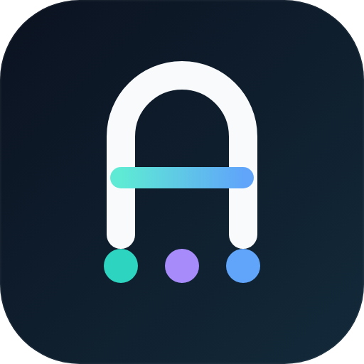
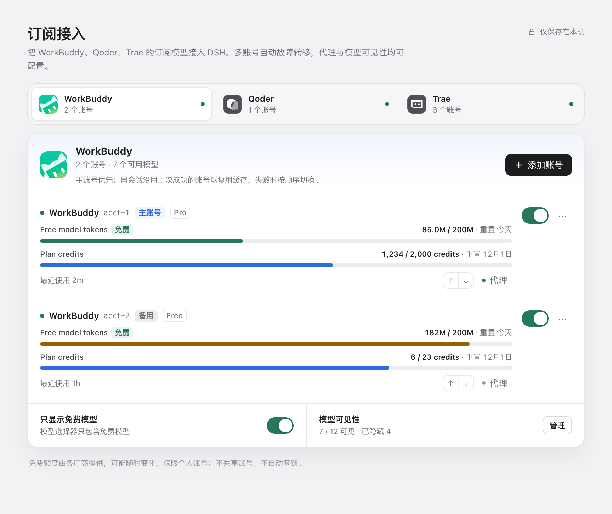
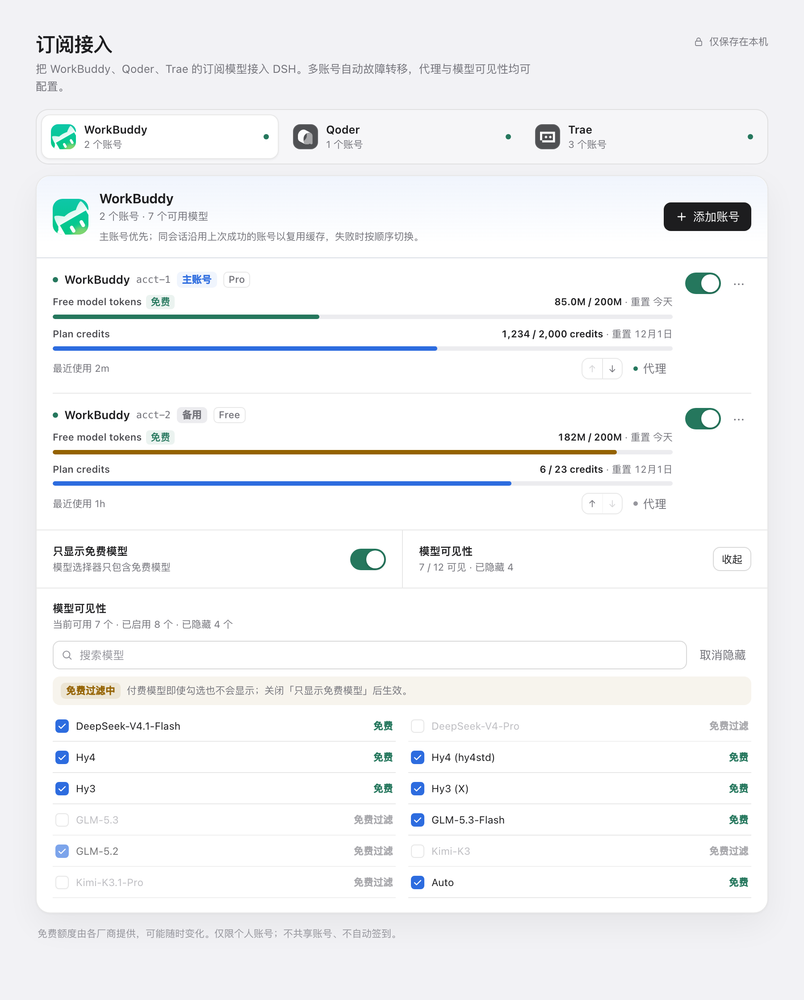
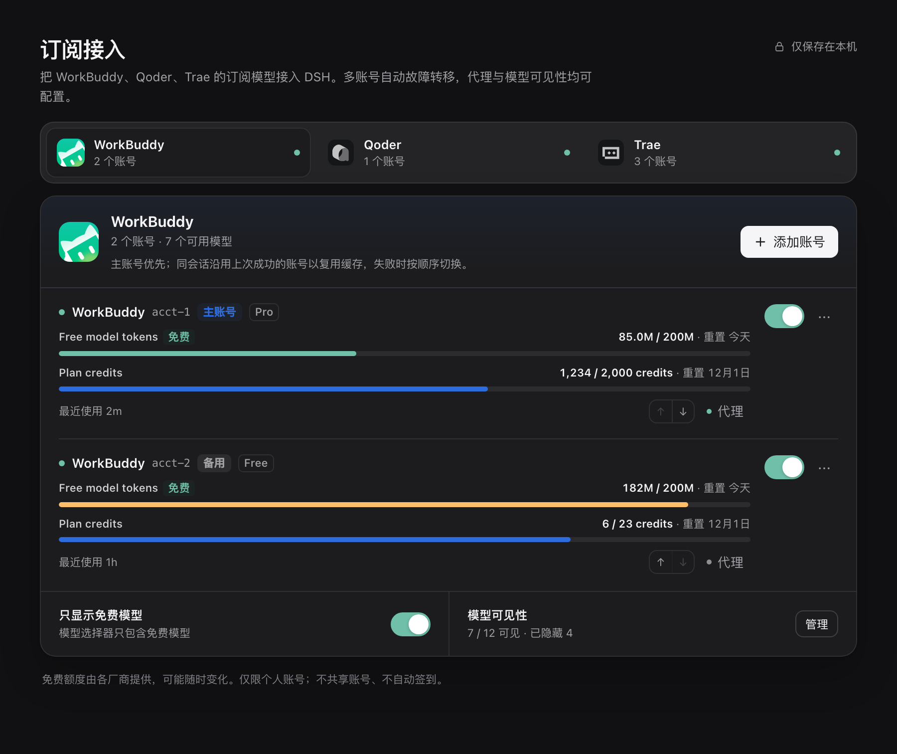
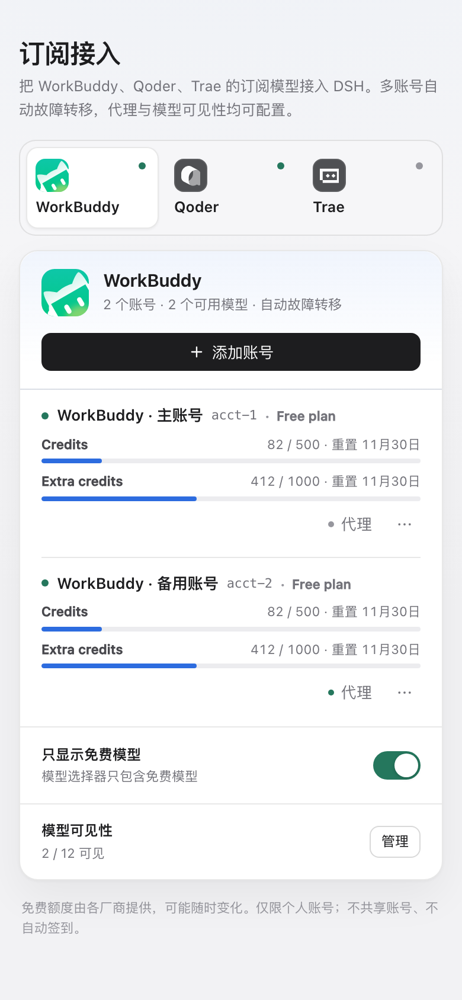

<p align="center">
  
</p>

<h1 align="center">dsh-hitchfin</h1>

<p align="center">
  <strong>Use your existing WorkBuddy, Qoder and Trae subscriptions inside DeepSeek Harness.</strong>
</p>
<p align="center">
  Multi-account failover · per-account HTTP(S) proxies · free-model filter · model visibility
</p>

<p align="center">
  <a href="README.zh.md">简体中文</a> ·
  <a href="#installation">Installation</a> ·
  <a href="#features">Features</a> ·
  <a href="#privacy-and-scope">Privacy</a> ·
  <a href="#development">Development</a>
</p>

<p align="center">
  
  
  
  
</p>



## Why dsh-hitchfin

DSH already has first-class API-key providers. `dsh-hitchfin` covers the other case: subscription plans you already pay for, accessed through their official account login flows.

It adds WorkBuddy CN, Qoder CN and Trae CN as native DSH model providers. Sign in with an official account, and the models you are entitled to appear in the DSH model picker. No account sharing, no automatic check-in, no attempt to bypass vendor limits.

## Features

- **Official channels** — WorkBuddy CN, Qoder CN and Trae CN, with their official app icons and official login flows.
- **Multi-account** — keep more than one account per channel. Add, re-authenticate or remove them without touching the others.
- **Automatic failover** — requests stay on the last working account for a session and model; authentication, quota, rate-limit, server or transport failures move the request to another account before any content is emitted.
- **Cooldown instead of hammering** — failed accounts cool down for a code-specific window; when every account is cooling down, DSH gets a clear retry time.
- **Per-account HTTP(S) proxies** — a proxy is applied to that account's sign-in, model list, usage and chat requests. Other accounts stay direct. Proxy credentials are masked in the UI and are never written to logs.
- **Free-model filter** — free-only is on by default. Channels without free/paid metadata (currently Trae CN) are shown in full instead of hiding everything.
- **Model visibility** — search the catalog, hide individual models, or hide paid models in one action. Visibility settings apply to the whole channel.
- **Native DSH UX** — channel tabs, inline quota progress, account menus, account-level proxy editor, model manager, toasts, dark mode and a 390px-wide layout.
- **One-click browser sign-in** — clicking browser sign-in opens the system browser directly with the official authorization URL. The settings page keeps a re-open link as a fallback, not as a required second click.
- **Local-first** — credentials live in DSH's credential store on this device. The plugin does not run telemetry or send account data anywhere except the vendor endpoints the channel package is designed to call.

## Screenshots

| Model visibility | Dark mode |
| --- | --- |
|  |  |

<p align="center">
  
</p>

## Installation

### From the DSH plugin market

Once listed, open **Plugins → Discover**, search for **dsh-hitchfin**, and install it from the card. Restart DSH if the host asks you to.

### From npm (web / CLI profiles)

Once the npm package is published:

```sh
dsh plugin --profile web add dsh-hitchfin
```

### From a local build

```sh
npm install
npm run build
npm pack
dsh plugin --profile web add ./dsh-hitchfin-0.4.1.tgz
```

The DSH Desktop profile is managed by the Electron application. Install through the app's **Plugins** page or the plugin market rather than editing the desktop profile by hand.

After installation, open **Settings → 订阅接入**.

### Requirements

- DSH `>= 0.2.2-rc.1`
- Node.js `>= 20.18.1` (the host runtime in current DSH desktop builds already satisfies this)
- macOS, Windows or Linux. Browser sign-in uses the platform's default-browser opener (`open`, `rundll32` or `xdg-open`).

## Quick start

1. Open **Settings → 订阅接入** and pick a channel.
2. Choose a sign-in method. Browser sign-in opens your default browser automatically; use API Key / PAT where the channel offers it.
3. Keep **Free models only** enabled unless you explicitly want paid models.
4. The channel's models appear in the DSH model picker. Add a second account or configure an account proxy at any time.

## Channels

| Channel | Status | Sign-in | Free/paid metadata | Verification |
| --- | --- | --- | --- | --- |
| WorkBuddy CN | Stable | Browser, API Key | Yes | Live model catalog and a real free-model chat request verified |
| Qoder CN | Stable | Browser, PAT | Yes | Login flow verified; live chat validation is on the roadmap |
| Trae CN | Experimental | Browser | No — all models are shown | Login flow verified; live catalog deduplicated from 90 internal IDs to 68 display models |

Channel support is powered by maintained OpenCode-compatible adapter packages. Vendor catalogs, quotas and free-tier rules can change at any time.

## Multi-account routing

Routing is deterministic and documented, not a black box:

- The route key is **provider + model + session**. A successful account becomes the preferred account for that key, protecting prompt-cache locality.
- If the preferred account fails before the first stream chunk, the adapter tries other signed-in accounts.
- Once any content has been emitted, the request is not switched mid-stream — you never get duplicated text from two accounts.
- Cooldowns:

| Failure | Cooldown |
| --- | --- |
| `AUTH` | 10 minutes |
| `QUOTA` | 15 minutes |
| `RATE_LIMIT` | 60 seconds, or `Retry-After` when provided |
| `SERVER` | 60 seconds |
| `TRANSPORT` | 30 seconds |
| `MODEL_NOT_FOUND` | 30 minutes, scoped to that account and model |

When all accounts are cooling down, the request fails with a retry time instead of repeatedly hitting the vendors. Re-authenticating an account, changing its proxy or removing it clears its routing state.

## Privacy and scope

- Credentials are stored through DSH's credential service; the plugin does not write tokens into its own config or expose them to the settings renderer.
- The settings page only receives models, quota summaries, masked account labels and a masked proxy URL.
- Requests go to the official vendor endpoints through the channel package. An optional proxy is per account and can be cleared at any time.
- This is a personal-account bridge. It does not share accounts, farm free tiers, automate check-in, bypass paywalls or evade rate limits.
- Free tiers are provided by the vendors and may change or disappear at any time. Use your own accounts and follow each vendor's terms.

## Compatibility

| Item | Requirement |
| --- | --- |
| DSH | `>= 0.2.2-rc.1` |
| Node.js | `>= 20.18.1` |
| Profiles | DSH Web and DSH Desktop |
| OS | macOS, Windows, Linux |
| DSH model UI | Model picker, per-model badges, reasoning effort metadata when provided by the channel |

## Development

```sh
npm install
npm run typecheck
npm run build
npm test
```

- `src/adapter/` — DSH `LlmAdapter`, model catalog merge and account routing.
- `worker/` — channel package host, proxy dispatcher and OpenAI-compatible stream bridge.
- `src/routes.ts` — local settings API: accounts, login, proxy, visibility.
- `src/client/` — native DSH settings section.
- `tests/` — adapter routing/cooldown/failover, account storage, proxy tunnel and SSE mapping tests.

See [docs/development-plan.md](docs/development-plan.md) for the design notes and verification history. Marketplace submission copy and the release checklist live in [docs/marketplace-listing.md](docs/marketplace-listing.md).

## Roadmap

- Qoder CN and Trae CN live chat verification.
- More granular per-account quota refresh diagnostics.
- Additional channels only when their official login and terms permit this kind of bridge.

Trae CN is intentionally marked experimental. OpenCode Zen is not part of this plugin.

## About

`dsh-hitchfin` is an independent community plugin for DeepSeek Harness. It is not affiliated with DeepSeek, Tencent, Alibaba, ByteDance or the maintainers of the channel adapter packages. WorkBuddy, Qoder, Trae and their logos are trademarks of their respective owners.

If you find a channel-package or vendor-side issue, please open an issue with the DSH version, channel, sign-in method and a redacted error message. Never paste access tokens, refresh tokens or full credential payloads.

## License

MIT. See [LICENSE](LICENSE).
