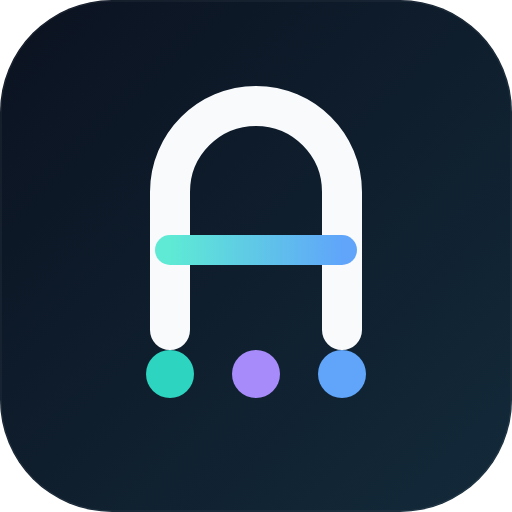
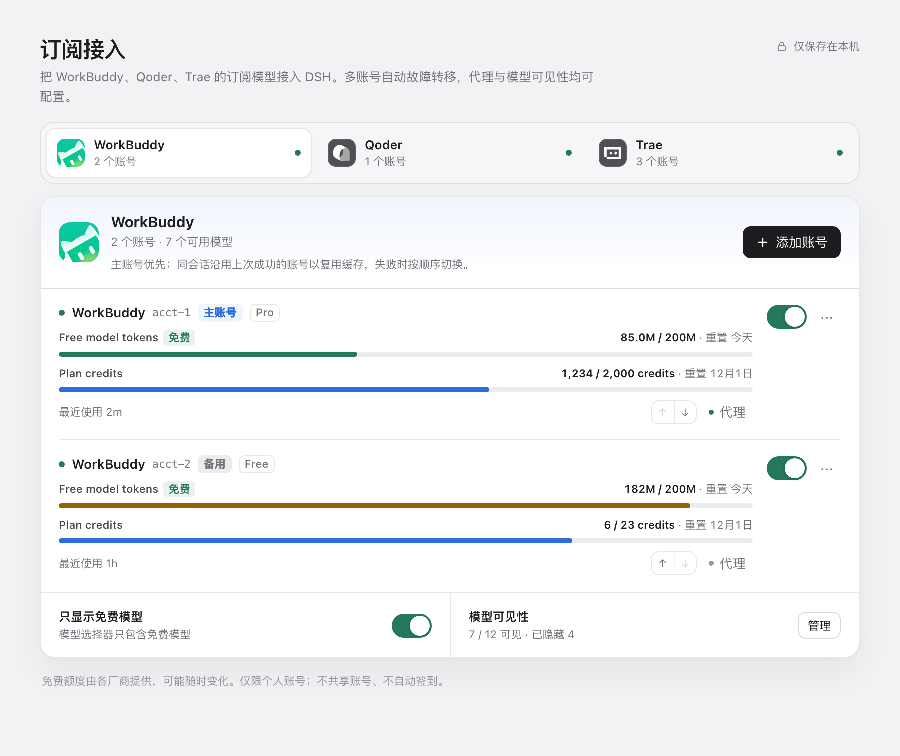
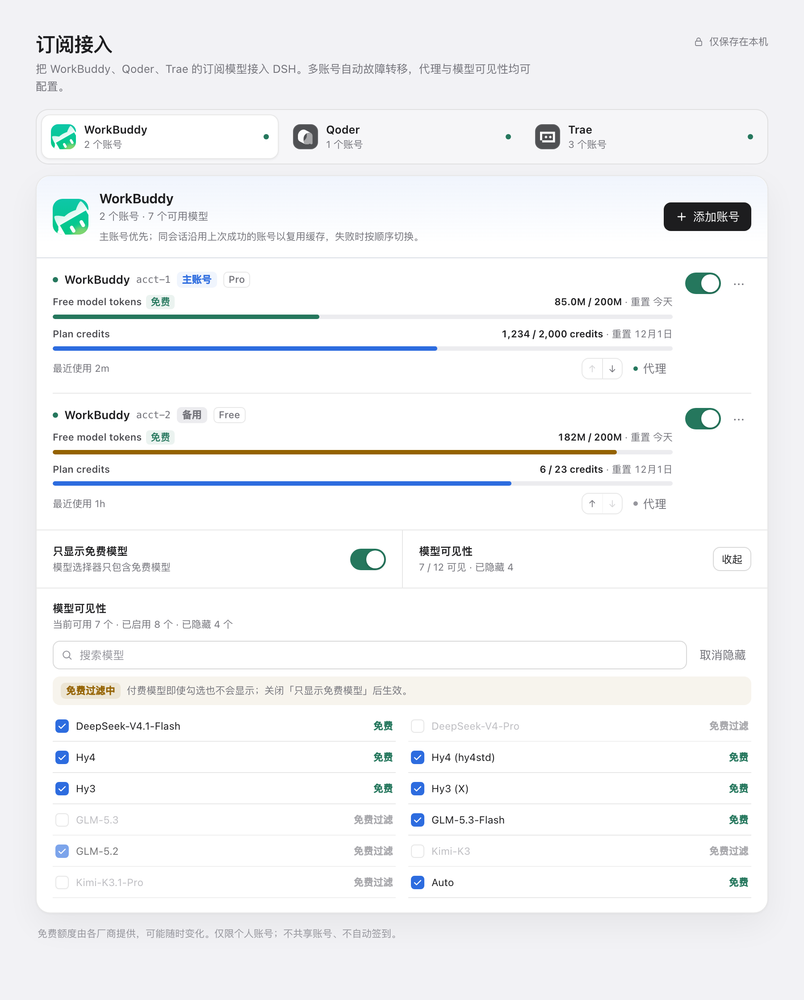
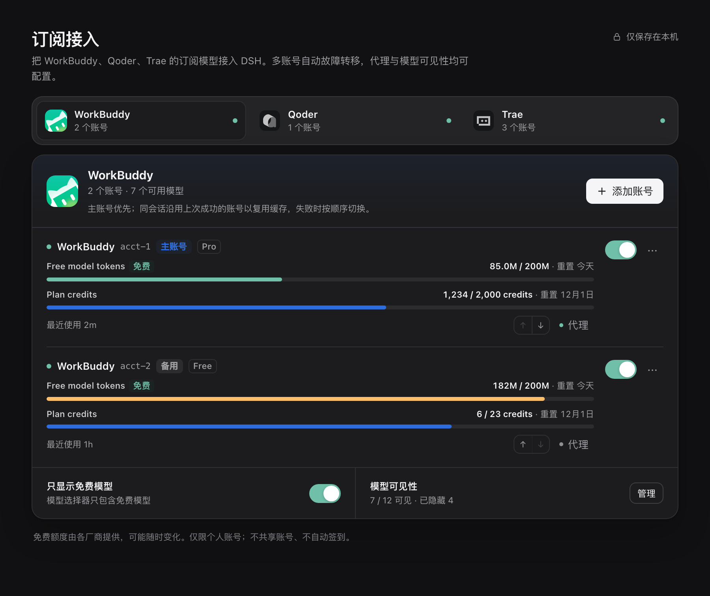
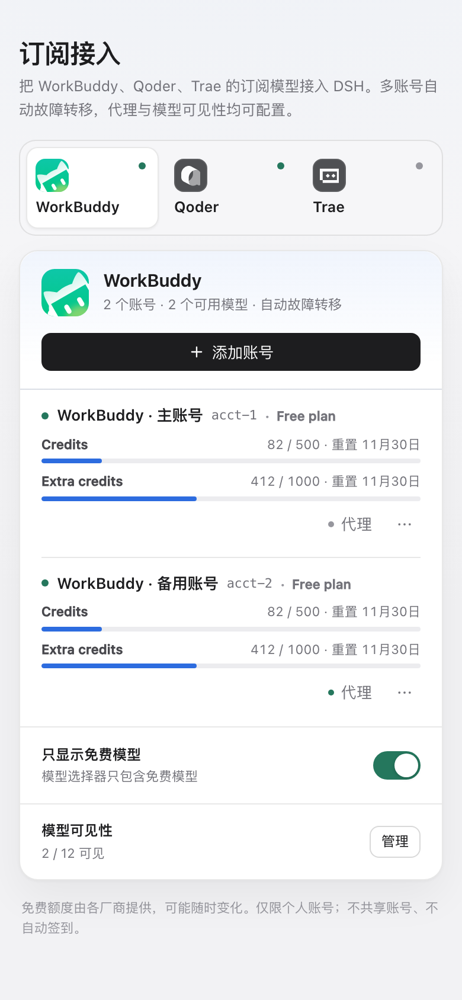

<p align="center">
  
</p>

<h1 align="center">dsh-hitchfin</h1>

<p align="center">
  <strong>把已在使用的 WorkBuddy、Qoder、Trae 订阅账号接进 DeepSeek Harness。</strong>
</p>
<p align="center">
  多账号故障转移 · 账号级 HTTP(S) 代理 · 免费模型过滤 · 模型可见性
</p>

<p align="center">
  <a href="README.md">English</a> ·
  <a href="#安装">安装</a> ·
  <a href="#功能">功能</a> ·
  <a href="#隐私与边界">隐私与边界</a> ·
  <a href="#开发">开发</a>
</p>

<p align="center">
  
  
  
  
</p>



## 为什么做这个插件

DSH 已经有完整的通用 API Key 供应商能力。`dsh-hitchfin` 覆盖的是另一类场景：你已经在付费或免费使用的订阅套餐，通过厂商官方账号登录来使用。

插件把 WorkBuddy CN、Qoder CN、Trae CN 注册成 DSH 原生模型供应商。用官方账号登录后，账号可用的订阅模型会出现在 DSH 模型选择器里。不共享账号、不自动签到、不尝试绕过厂商限制。

## 功能

- **官方渠道**：WorkBuddy CN、Qoder CN、Trae CN，使用官方应用图标和官方登录流程。
- **多账号**：同一渠道可保存多个账号，独立添加、重新登录、删除，互不影响。
- **自动故障转移**：同一会话、同一模型优先使用上次成功的账号；鉴权、额度、限流、服务端或传输失败时，在输出任何内容前切换到其他账号。
- **冷却而非硬碰**：失败账号按错误类型进入冷却；全部账号冷却时，请求会明确返回重试时间。
- **账号级 HTTP(S) 代理**：代理只作用于该账号的登录、模型列表、额度与聊天请求；其他账号保持直连。代理凭据在界面中掩码，不写入日志。
- **免费模型过滤**：默认只显示免费模型；没有免费/付费元数据的渠道（目前是 Trae CN）会显示全部模型，而不是全部隐藏。
- **模型可见性**：支持搜索模型、逐个隐藏、隐藏全部付费模型；设置对整个渠道生效。
- **原生 DSH 界面**：频道 Tab、额度进度、账号菜单、行内代理编辑、模型管理、Toast、暗色模式与 390px 窄屏适配。
- **浏览器登录直达**：点击浏览器登录后直接拉起系统默认浏览器；设置页里的「重新打开」只是兜底，不是必需第二次点击。
- **本地优先**：凭据保存在本机 DSH credential store；插件不做遥测，也不会把账号数据发到除渠道包指定厂商接口以外的地方。

## 截图

| 模型可见性 | 暗色模式 |
| --- | --- |
|  |  |

<p align="center">
  
</p>

## 安装

### 从 DSH 插件市场安装

插件收录后，打开 **插件 → 发现**，搜索 **dsh-hitchfin**，从卡片直接安装。宿主提示需要重启时重启 DSH。

### 从 npm 安装（Web / CLI profile）

npm 包发布后：

```sh
dsh plugin --profile web add dsh-hitchfin
```

### 从本地构建安装

```sh
npm install
npm run build
npm pack
dsh plugin --profile web add ./dsh-hitchfin-0.3.1.tgz
```

DSH Desktop 的 desktop profile 由 Electron 应用独占管理，请通过应用的 **插件** 页面或插件市场安装，不要手动修改 desktop profile。

安装完成后打开 **设置 → 订阅接入**。

### 环境要求

- DSH `>= 0.2.2-rc.1`
- Node.js `>= 20.18.1`（当前 DSH Desktop 自带运行时已满足）
- macOS、Windows 或 Linux。浏览器登录使用平台默认浏览器打开方式（`open`、`rundll32` 或 `xdg-open`）。

## 快速开始

1. 打开 **设置 → 订阅接入**，选择一个渠道。
2. 选择登录方式。浏览器登录会自动打开默认浏览器；渠道支持时也可以使用 API Key / PAT。
3. 默认保持「只显示免费模型」；需要付费模型时再手动关闭。
4. 模型会出现在 DSH 模型选择器里。之后可随时添加第二账号或配置账号代理。

## 渠道

| 渠道 | 状态 | 登录方式 | 免费/付费标记 | 验证情况 |
| --- | --- | --- | --- | --- |
| WorkBuddy CN | 稳定 | 浏览器、API Key | 有 | 已验证真实模型目录与真实免费模型对话 |
| Qoder CN | 稳定 | 浏览器、PAT | 有 | 已验证登录链路；真实对话验证在路线图中 |
| Trae CN | 实验性 | 浏览器 | 无，显示全部模型 | 已验证登录链路；真实模型目录已从 90 个内部 ID 去重为 68 个显示模型 |

渠道能力来自持续维护的 OpenCode 兼容适配包。厂商模型目录、额度和免费层规则可能随时变化。

## 多账号路由

路由规则是确定且可解释的：

- 路由键是 **供应商 + 模型 + 会话**。成功后该键优先使用这个账号，保护 prompt cache 命中。
- 首选账号在输出首个流式内容前失败时，会尝试其他已登录账号。
- 一旦已经开始输出内容，不会中途换号，避免同一段回复出现两份文本。
- 冷却时间：

| 失败类型 | 冷却时间 |
| --- | --- |
| `AUTH` | 10 分钟 |
| `QUOTA` | 15 分钟 |
| `RATE_LIMIT` | 60 秒；厂商提供 `Retry-After` 时以其为准 |
| `SERVER` | 60 秒 |
| `TRANSPORT` | 30 秒 |
| `MODEL_NOT_FOUND` | 30 分钟，仅作用于该账号和该模型 |

全部账号冷却时，请求会返回明确的重试时间，而不是继续请求厂商。重新登录、修改代理或删除账号会清理该账号的路由状态。

## 隐私与边界

- 凭据通过 DSH credential service 保存；插件不会把 token 写进自己的配置，也不会暴露给设置页渲染层。
- 设置页只接收模型列表、额度摘要、掩码后的账号标签与代理地址。
- 请求通过渠道包发往厂商官方接口；代理是可选的、按账号配置的，可随时清除。
- 这是个人账号桥接工具：不共享账号、不刷免费额度、不自动签到、不绕过付费墙或限流。
- 免费额度由厂商提供，可能随时变化或取消。请使用自己的账号并遵守各厂商条款。

## 兼容性

| 项目 | 要求 |
| --- | --- |
| DSH | `>= 0.2.2-rc.1` |
| Node.js | `>= 20.18.1` |
| Profile | DSH Web、DSH Desktop |
| 系统 | macOS、Windows、Linux |
| 模型界面 | 模型选择器、模型 badge、渠道提供时的 reasoning effort 元数据 |

## 开发

```sh
npm install
npm run typecheck
npm run build
npm test
```

- `src/adapter/`：DSH `LlmAdapter`、模型目录合并与账号路由。
- `worker/`：渠道包宿主持久化、代理 dispatcher 与 OpenAI 兼容流桥接。
- `src/routes.ts`：本地设置 API，覆盖账号、登录、代理、模型可见性。
- `src/client/`：DSH 原生设置页。
- `tests/`：路由/冷却/故障转移、账号存储、代理隧道与 SSE 映射测试。

设计说明与验证记录见 [docs/development-plan.md](docs/development-plan.md)。插件市场提交文案与发布检查清单见 [docs/marketplace-listing.md](docs/marketplace-listing.md)。

## 路线图

- Qoder CN、Trae CN 真实对话验证。
- 更细的按账号额度刷新诊断。
- 仅在官方登录方式和条款允许时增加新渠道。

Trae CN 仍标记为实验性。OpenCode Zen 不包含在此插件中。

## 关于

`dsh-hitchfin` 是面向 DeepSeek Harness 的独立社区插件，与 DeepSeek、腾讯、阿里巴巴、字节跳动及渠道适配包维护方没有隶属关系。WorkBuddy、Qoder、Trae 及相关图标是各自权利人的商标。

如果遇到渠道包或厂商侧问题，请附上 DSH 版本、渠道、登录方式和脱敏后的错误信息提交 issue。不要粘贴 access token、refresh token 或完整凭据。

## License

MIT，详见 [LICENSE](LICENSE)。
