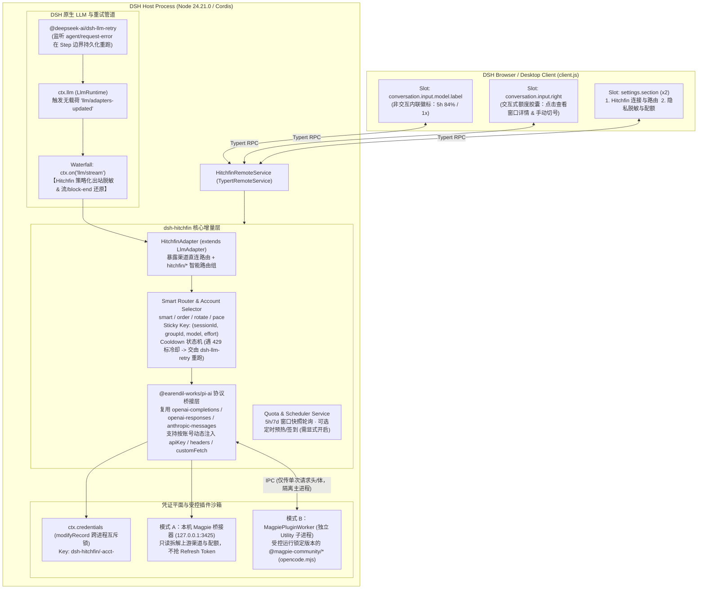

# 01 · 系统架构设计方案 (System Architecture & Technical Design)

本文档定义 `dsh-hitchfin` 在 DeepSeek Harness (`dsh` `0.2.1-rc.5`) 体系内的整体架构、与官方原生 Seam 的协同边界、双轨运行模式及工程目录结构。所有接口名称均已对齐 [`00-verification.md`](./00-verification.md)。

---

## 1. 宿主运行基线与原生 Seam 依赖

* **目标宿主版本**：DeepSeek Harness Desktop / Web **`0.2.1-rc.5`**
* **内置运行时**：Node `24.21.0` / pnpm `11.28.5`
* **注入与复用的 DSH 原生服务 (`inject`)**：
  * `llm` (`LlmRuntime` from `@deepseek-ai/dsh-llm`)：通过 `ctx.llm.registerAdapter(routes, adapter)` 与 `ctx.llm.registerConfigurableProviders(entries)` 注册渠道及路由组；通过 `ctx.on('llm/stream', waterfall)` 挂载全局出站隐私脱敏拦截器。
  * `credentials` (`CredentialProvider` from `@deepseek-ai/dsh-credentials`)：通过 `ctx.credentials.modifyRecord(credentialKey('dsh-hitchfin', id), mutate)` 存储多账号凭证与脱敏密钥 Salt，直接复用其跨进程排他锁。
  * `authorization` (`@deepseek-ai/dsh-authorization`)：通过 `ctx.authorization.registerFlow(...)` 注册 OAuth / Device Code / API Key 交互式登录流。
  * `settings` (`@deepseek-ai/dsh-settings`)：持久化非敏感配置（路由组定义、渠道开关、脱敏策略）。
  * `tokenMeter` (`@deepseek-ai/dsh-token-meter`)：直接复用原生 Token 与上下文计量能力，不再重复建设本地 JSONL Token 账本。
* **复用的底层协议库**：
  * `@earendil-works/pi-ai`（宿主已内置）：直接复用其 `openai-completions`、`openai-responses`、`anthropic-messages` 协议转换与 `ReplayEnvelope` 机制。
* **前后端 RPC 通信**：
  * 服务端继承 `TypertRemoteService` (`@deepseek-ai/dsh-typert-protocol`)，天然享受 DSH 宿主的连接鉴权、Origin 校验与类型安全，**不再自建裸 HTTP `/api/hitchfin/*` 接口**。

---

## 2. 总体架构图（原生 Seam 协同模型）



---

## 3. 双轨连接模式设计（解决外部 Magpie 共存与迁移问题）

针对用户本机可能已安装外部 Magpie (`127.0.0.1:3425`) 的实际情况，`dsh-hitchfin` 提供清晰的双轨运行模式，避免两个进程同时刷新同一个 OAuth `refresh_token` 导致账号被踢下线：

### 模式 A：Magpie Sidecar 协同桥接模式（检测到 `127.0.0.1:3425` 存活时的零风险模式）
* **不触碰 `refresh_token`**：插件不复制 `~/.config/magpie/logins.json` 中的 OAuth 刷新令牌，所有上游刷新仍由外部 Magpie 进程独立完成。
* **解决静态 `cordis.patch.yml` 痛点**：
  * 自动读取 Magpie 的 `/v1/models` 及渠道归属元数据，在内存里通过 `ctx.llm.registerAdapter` 动态拆分为按真实渠道命名的 Provider（如 `Hitchfin · Codex`、`Hitchfin · WorkBuddy`、`Hitchfin · Trae`），彻底告别「所有模型全塞在一个 `Magpie` 桶里、每次变动都要手改 YAML」的体验。
  * 实时拉取 Magpie 的配额快照，通过 `conversation.input.model.label` 与 `conversation.input.right` 在 DSH 输入框直接显示 5h/7d 额度进度环。

### 模式 B：Hitchfin 原生独立多号池模式（无需外部 Magpie 守护进程）
* **原生 OAuth / API Key 多账号池**：
  * 通过 `ctx.authorization.registerFlow` 提供官方 OAuth / Device Code / API Key 登录，支持同一渠道添加多个账号，凭证存储在 `ctx.credentials` 的 `dsh-hitchfin/<channel>-acct-<n>` 记录中。
* **从 Magpie 单向安全迁移（含锁检查与备份）**：
  * 若用户选择「停用外部 Magpie 并迁移至 Hitchfin 独立管理」，迁移器首先检查 `~/.config/magpie/*.lock` 确认外部 Magpie 已退出，备份原配置后将凭证导入 `ctx.credentials`，并清理 `~/.dsh/profiles/desktop/cordis.patch.yml` 中的旧静态代理配置。
* **隔离子进程运行 `@magpie-community/*` 插件**：
  * 在独立 Node 子进程（`child_process.fork`）中加载经版本锁定与 SHA-256 校验的 `@magpie-community/opencode-*-auth` 包（入口为 `opencode.mjs` / `opencode2.mjs`），主进程仅通过受控 IPC 传递当前被选账号的认证快照与请求参数。

---

## 4. 工程目录结构规划（精简收敛版）

```text
dsh-hitchfin/
├── package.json                      # 对齐 DSH 0.2.1-rc.5 peerDependencies 与 dsh.client
├── cordis.patch.yml                  # 单行 insert 挂载 dsh-hitchfin
├── tsconfig.json                     # Host 端 TypeScript 配置 (Node 24.21.0)
├── tsconfig.client.json              # Browser 端 TypeScript 配置
├── assets/
│   └── icon.svg                      # Hitchfin 插件图标
├── locale/
│   ├── zh.json                       # 简体中文词典
│   └── en.json                       # 英文词典
├── docs/                             # 架构与规范文档中心 (00 ~ 05)
├── src/                              # Host 半身源码 (编译输出至 lib/)
│   ├── index.ts                      # Cordis 主入口：装配服务、注册 Adapter 与 Waterfall
│   ├── config.ts                     # Schemastery 配置定义
│   ├── types.ts                      # 共享类型与 Typert Remote 接口声明
│   ├── remote.ts                     # HitchfinRemoteService (继承 TypertRemoteService)
│   ├── adapter/
│   │   ├── hitchfin-adapter.ts       # 实现 LlmAdapter，借助 @earendil-works/pi-ai 执行流式调用
│   │   └── replay.ts                 # 复用并校验 ReplayEnvelope (保留 reasoning 签名与 responseId)
│   ├── channels/
│   │   ├── pool.ts                   # 基于 ctx.credentials.modifyRecord 的多账号池与状态机
│   │   ├── flows.ts                  # 基于 ctx.authorization 的多账号登录流注册
│   │   ├── magpie-bridge.ts          # 模式 A：本机 127.0.0.1:3425 动态渠道分拆与额度同步桥
│   │   ├── magpie-migrator.ts        # 模式 B：带锁检测与回滚备份的 ~/.config/magpie 单向迁移器
│   │   ├── plugin-worker-host.ts     # 模式 B：管理独立子进程的 IPC 宿主
│   │   ├── plugin-worker-entry.ts    # 子进程入口：加载 opencode.mjs / opencode2.mjs 插件
│   │   └── quota-scheduler.ts        # 5h/7d 配额快照查询 + 可选定时预热/签到 (默认关闭)
│   ├── router/
│   │   ├── group-router.ts           # 路由组解析与 smart / order / rotate / pace 选号器
│   │   ├── sticky-cache.ts           # 复合键 (sessionId, groupId, model, effort) 并发安全粘性表
│   │   └── cooldown.ts               # 429 / 额度耗尽冷却表 (配合 dsh-llm-retry 实现 Step 级切号)
│   └── masking/
│       ├── waterfall.ts              # 挂载于 ctx.on('llm/stream') 的双向脱敏拦截器
│       ├── matcher.ts                # 复用线性前缀扫描思路的凭证/PII 检测器
│       ├── stream-unmasker.ts        # 支持 *-delta 与 block-end.block 的滑窗还原器 (含 JSON 转义)
│       └── policy-guard.ts           # 防 Tool Call 外泄策略检查器 (拦截向网络/Shell 工具还原密钥)
└── client/                           # Browser 半身源码 (编译至 client/client.js)
    ├── index.tsx                     # 注册 conversation.input.model.label、input.right 与 2 个 settings.section
    └── components/
        ├── ModelQuotaBadge.tsx       # 挂载于 conversation.input.model.label 的非交互内联额度徽标
        ├── ComposerQuotaCapsule.tsx  # 挂载于 conversation.input.right 的交互式额度详情与快速切号弹窗
        ├── ConnectionRoutingPage.tsx # Settings Section 1：渠道多号池、Magpie 桥接/迁移、智能路由组
        └── PrivacyQuotaPage.tsx      # Settings Section 2：出站脱敏策略、测试沙盒与全渠道配额看板
```
