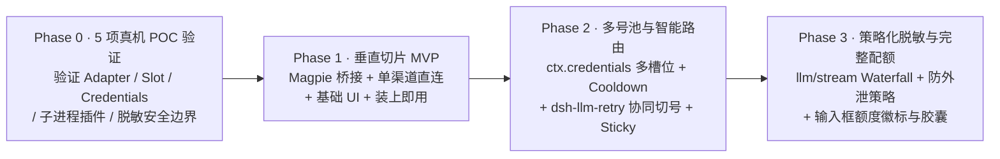

# 05 · 分阶段开发计划（含 Phase 0 POC）与测试矩阵 (Roadmap, Verification & Test Plan)

遵循「先验证事实边界、再做最小垂直切片、最后扩展能力」的务实工程路线，我们将项目重新规划为 **Phase 0（Go/No-Go 真机 POC） $\rightarrow$ Phase 1（最小垂直切片 MVP） $\rightarrow$ Phase 2（多账号池与智能路由组） $\rightarrow$ Phase 3（策略化出站脱敏与配额 UI）**。

> **测试运行环境铁律**：所有构建、单元测试与集成测试必须使用 DSH Desktop 自带的 **Node `24.21.0`** 与 **pnpm `11.28.5`** 执行，确保与宿主运行时 100% 一致。

---

## 阶段总览图

---

## Phase 0：5 项 Go/No-Go 真机 POC 验证（已全部通过 ✅）

在编写大规模业务代码前，已使用本机 DSH Desktop (`0.2.1-rc.5`) 自带的 Node `24.21.0` 跑通以下 5 个技术验证点（见 `tests/poc/poc1`–`poc5`）：

- [x] **POC-1：`LlmAdapter` 注册与流式全链路验证**（[`tests/poc/poc1-llm-adapter.spec.ts`](../tests/poc/poc1-llm-adapter.spec.ts)）
  - 继承抽象类 `LlmAdapter` 并调用 `ctx.llm.registerAdapter(['hitchfin-codex'], adapter)` 注册路由；
  - 验证无载荷 `'llm/adapters-updated'` 事件触发及 `probeMagpieGateway('http://127.0.0.1:3425')` 渠道自动归类；
  - 验证 `block-start` $\rightarrow$ `reasoning-delta` $\rightarrow$ `text-delta` $\rightarrow$ `block-end` $\rightarrow$ `usage` $\rightarrow$ `finish` 通过真实 `BlockAssembler.blocks()` 校验。
- [x] **POC-2：客户端 `window.__ModuleLoader__.load` 与三大原生 Slot 挂载验证**（[`tests/poc/poc2-client-slots.spec.ts`](../tests/poc/poc2-client-slots.spec.ts)）
  - 验证构建产物 `client/client.js` 通过 `window.__ModuleLoader__.load({ id: 'dsh-hitchfin', factory })` 注册；
  - 验证 `conversation.input.model.label`、`conversation.input.right` 与 2 个 `settings.section` 页面挂载。
- [x] **POC-3：`ctx.credentials` 多槽位互斥读写与 Step 边界协同切号验证**（[`tests/poc/poc3-credentials-and-retry.spec.ts`](../tests/poc/poc3-credentials-and-retry.spec.ts)）
  - 验证 `credentialKey('dsh-hitchfin', 'hitchfin-codex-acct-slot-1')` 并发刷新时仅发起 1 次上游刷新请求；
  - 验证账号 1 返回 `429` 时进入 `Cooldown`、抛出 `LlmError(..., 'RATE_LIMIT', { status: 429, providerRetryAfterMs: 100 })`，并在下一次 Step 重跑时自动命中账号 2。
- [x] **POC-4：独立子进程运行本机 3 个 `@magpie-community` 插件验证**（[`tests/poc/poc4-community-plugin-worker.spec.ts`](../tests/poc/poc4-community-plugin-worker.spec.ts)）
  - 使用 `child_process.fork` 加载本机 `~/.config/magpie/plugins/node_modules/@magpie-community/opencode-{workbuddy,trae,zcode}-auth/opencode.mjs`，全部成功导出 `auth` 钩子与认证方式列表。
- [x] **POC-5：出站脱敏边界与防外泄测试**（[`tests/poc/poc5-masking-and-guard.spec.ts`](../tests/poc/poc5-masking-and-guard.spec.ts)）
  - 验证 `llm/stream` Waterfall 对 `Object.freeze` 请求的脱敏克隆；
  - 验证含引号/换行的密钥跨 3 个分片切分时在安全工具（`write_config`）中完成 JSON 安全转义并通过 `JSON.parse()`，同时在高危工具（`bash` 执行 `curl`）中被 `PolicyGuard` 拦截阻断外泄。
  - **额外关键发现（macOS Hardened Runtime 签名约束）**：DSH Desktop 内置的 `node` 二进制启用了 Apple Team ID Library Validation，任何第三方 `.node` 原生扩展（如 `@rollup/rollup-darwin-arm64`）都会因 Team ID 不一致被 `dlopen` 拒绝（`ERR_DLOPEN_FAILED`）。因此 `dsh-hitchfin` 必须保持 **100% 纯 JS/ESM 零原生 addon**，测试统一采用 Node 24 原生 `node --test` 运行器。

---

## Phase 1：最小垂直切片 MVP —— 「装上即用，平滑接管/桥接」（已全部完成 ✅）

### 1.1 目标
先交付一个**小而极其扎实**的可用版本：打通 **「模式 A（本机 Magpie `127.0.0.1:3425` 动态渠道拆分桥接）+ 模式 B（基于 `@earendil-works/pi-ai` 的单渠道直连）+ 最小设置面板」**。

### 1.2 交付清单
- [x] **M1.1 标准插件工程与 Git 基线**：
  - 提交经评审定稿的 `docs/00`–`05` 文档基线；
  - 建立 `package.json`、`cordis.patch.yml`、双端 TypeScript 构建配置与 Host HTTP 通信层（[`src/rpc/http-routes.ts`](../src/rpc/http-routes.ts)）。
- [x] **M1.2 模式 A：Magpie 动态渠道桥接器 (`magpie-bridge.ts` & `openai-sse-transport.ts`)**：
  - 自动探测 `127.0.0.1:3425`，将其暴露的模型按真实渠道（Codex、WorkBuddy、Trae CN 等）动态拆分为独立 Provider 注册到 `ctx.llm`，支持 `handle.replace()` 动态热更新，无需手改 `cordis.patch.yml`，也不抢夺 `refresh_token`。
- [x] **M1.3 模式 B：基于 `@earendil-works/pi-ai` 的原生 Adapter (`hitchfin-adapter.ts` & `pi-ai-transport.ts`)**：
  - 复用 `@earendil-works/pi-ai` 的 `openai-completions`、`openai-responses`、`anthropic-messages` 协议实现与版本 2 `ReplayEnvelope`。
- [x] **M1.4 最小设置页 (`src/client/index.tsx`)**：
  - 在 `settings.section` 中展示连接状态、渠道列表与模式切换开关（`auto` / `bridge` / `standalone`）。

---

## Phase 2：多账号订阅池与智能路由组（已全部完成 ✅）

### 2.1 交付清单
- [x] **M2.1 基于 `ctx.credentials` 的多账号池与 `ctx.authorization` 登录流 (`pool.ts` & `flows.ts`)**
- [x] **M2.2 受控子进程 `MagpiePluginWorker` (`plugin-worker-host.ts` & `plugin-worker.ts`)**：接入本机已验证的 `@magpie-community` 渠道包。
- [x] **M2.3 智能路由组引擎 (`group-router.ts` & `sticky-cache.ts` & `cooldown.ts`)**：
  - 实现 `order`、`rotate`、`smart`、`pace` 四种选号策略与跨渠道 `RoutingGroupConfig`；
  - 实现复合键 `(sessionId, groupId, model, effort)` 的并发安全 Sticky Session；
  - 实现与 `@deepseek-ai/dsh-llm-retry` 联动的 Step 级无损 Failover。

---

## Phase 3：策略化出站脱敏与原生配额 UI（已全部完成 ✅）

### 3.1 交付清单
- [x] **M3.1 `llm/stream` Waterfall 出站脱敏与防外泄守卫 (`src/masking/`)**：
  - 实现 `{{HF_SEC_xxxxxxxx}}` 统一占位符与 `ctx.credentials` 持久化 Salt（[`saveToCredentials` / `loadFromCredentials`](../src/masking/placeholder.ts)）；
  - 实现 `StreamingUnmasker`（覆盖 `*-delta` 与 `block-end.block`、JSON 字符串转义）与 `policy-guard.ts`（阻断向高危 Shell/网络工具自动还原密钥）。
- [x] **M3.2 输入框内联额度徽标 (`HitchfinModelLabel`) 与交互式额度胶囊 (`HitchfinComposerQuotaCapsule`)**
- [x] **M3.3 隐私与配额设置页 (`HitchfinPrivacySettingsPage`)** 及完整 `cordis.patch.yml` 备份/回滚清理工具（[`src/migration/backup-restore.ts`](../src/migration/backup-restore.ts)）。

---

## 4. 专项测试矩阵 (`Test Plan`)

| 测试类别 | 核心测试用例 | 预期通过标准 |
| :--- | :--- | :--- |
| **1. DSH 契约兼容性测试** | 校验 `LlmAdapter` 发出的所有 `StreamChunk`（特别是 `reasoning-delta`、`block-end.block`、`finish.reason.failure`、`usage` 未缓存输入扣减） | 通过 DSH `BlockAssembler` 与 `expandAssistantStream` 严格校验，零类型/运行时断言错误 |
| **2. Failover & Retry 混沌测试** | Mock 上游服务器对账号 #1 返回 `429 (Retry-After: 1)`、`502`、首包超时 | 账号 #1 进入 `Cooldown`；`dsh-llm-retry` 在 Step 边界重跑并自动切换至账号 #2；会话日志无残留半截块 |
| **3. 并发刷新互斥测试** | 两个并发请求同时触发同一个即将过期账号的 OAuth Refresh | `ctx.credentials.modifyRecord` 排他锁生效，仅发起 1 次上游刷新请求，无 Token 旋转失效 |
| **4. 脱敏 Fuzz 与安全红队测试** | • 含双引号 `"`、反斜杠 `\`、换行 `\n` 的密钥跨 chunk 切分测试 • 模拟 Prompt Injection 调用 `bash` 执行 `curl ... {{HF_SEC_xxx}}` • 重启宿主进程后继续旧会话引用历史占位符 | • `ToolCallBlock.arguments` 始终为合法 JSON，且 `block-end.block` 同步更新 • 高危工具调用中的占位符被 `policy-guard` 拦截，绝不外发真实密钥 • 重启后凭持久化 Salt 正常识别旧占位符 |
| **5. 卸载与回滚干净度测试** | 在设置页执行「从 Magpie 迁移回滚」或禁用/卸载 `dsh-hitchfin` | 原 `cordis.patch.yml` 完整恢复，无孤儿 Worker 进程残留 |
